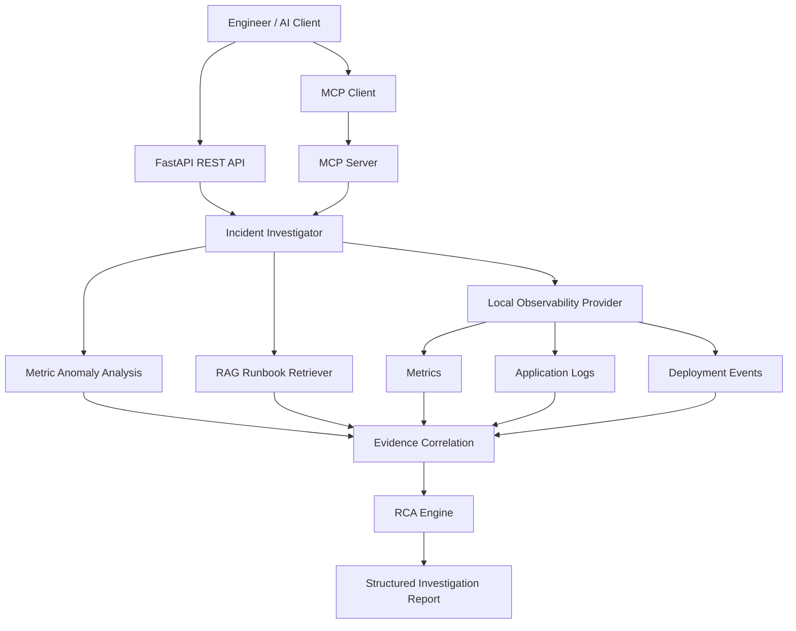

# OpsPilot — Agentic AI Incident Investigator

OpsPilot is an agentic AI system that investigates application incidents by correlating observability metrics, application logs, deployment events, and runbook knowledge. It produces a structured root-cause analysis (RCA), supporting evidence, confidence assessment, and recommended remediation steps.

The project exposes investigation capabilities through a FastAPI application and a Model Context Protocol (MCP) server, allowing tools and compatible AI clients to access incident-investigation functionality.

> **Demo status:** The current demonstration uses local/simulated observability data. It is a prototype, not a live production monitoring or autonomous remediation system. Uploaded incident reports are treated as unverified user-provided context.

## Features

- **Incident investigation:** Collects service metrics, logs, recent deployment information, and relevant runbook guidance.
- **Metric anomaly analysis:** Compares observed metrics against a baseline and identifies significant changes.
- **Evidence correlation:** Combines metric trends, application logs, deployment events, and reported symptoms into an investigation timeline.
- **RAG-based runbook retrieval:** Uses semantic retrieval to find relevant troubleshooting procedures.
- **Root-cause analysis:** Generates a likely cause, confidence assessment, supporting evidence, missing evidence, and next steps.
- **Incident report context:** Accepts user-provided incident information without automatically treating it as verified telemetry.
- **REST API:** Exposes the application through FastAPI.
- **MCP integration:** Makes investigation, metrics, and runbook-search tools available over Streamable HTTP.

## Architecture



## Technology Stack

- **Backend API:** Python, FastAPI, Uvicorn
- **Agent/tool integration:** Model Context Protocol (MCP), FastMCP
- **Retrieval:** Embeddings and semantic runbook search
- **Investigation inputs:** Metrics, logs, deployment metadata, and incident reports
- **Testing:** pytest
- **Observability demonstration:** Local/simulated data fixtures

Refer to the implementation and dependency file for the exact versions and optional integrations used by the current checkout.

## Project Structure

```text
OpsPilot/
├── app/
│   ├── main.py
│   ├── mcp_server.py
│   ├── tools/
│   │   ├── investigation.py
│   │   └── metrics.py
│   ├── observability/
│   │   ├── investigator.py
│   │   └── local.py
│   └── rag/
│       └── retriever.py
├── requirements.txt
├── pytest.ini
└── README.md
```

The tree above highlights the main modules used by the current implementation; additional files may exist in the repository.

## Prerequisites

- Python 3.12, matching the development environment
- Git
- A Windows PowerShell terminal or an equivalent shell
- Network access on initial setup if Python dependencies or embedding models need to be downloaded

## Installation

Clone the repository and enter its directory:

```powershell
git clone https://github.com/Srinu0725/opspilot.git
cd OpsPilot
```

Create and activate a virtual environment:

```powershell
py -3.12 -m venv .venv
.\.venv\Scripts\Activate.ps1
```

Install dependencies:

```powershell
python -m pip install --upgrade pip
python -m pip install -r requirements.txt
```

Ensure `requirements.txt` includes the MCP dependency:

```text
mcp==1.30.0
```

If the repository uses environment variables, configure them according to the settings required by the implementation. Do not commit credentials, API keys, or other secrets.

## Running OpsPilot

Run the REST API in one terminal:

```powershell
.\.venv\Scripts\python.exe -m uvicorn app.main:app --reload --port 8002
```

Open the interactive API documentation:

- Swagger UI: http://127.0.0.1:8002/docs
- OpenAPI schema: http://127.0.0.1:8002/openapi.json

Run the MCP server in a separate terminal:

```powershell
.\.venv\Scripts\python.exe -m app.mcp_server
```

The default MCP endpoint is:

```text
http://127.0.0.1:8000/mcp
```

The MCP server supports the Streamable HTTP transport. Its default host is configured through `MCP_HOST`, and its port uses `PORT` or `MCP_PORT`, defaulting to `8000`.

## MCP Tools

OpsPilot currently registers three MCP tools.

| Tool | Purpose |
|---|---|
| `investigate_service(service)` | Runs an investigation for a service |
| `get_metrics(service)` | Retrieves service telemetry |
| `find_runbook_guidance(service, query, top_k)` | Retrieves relevant runbook sections |

Example MCP tool arguments:

```json
{
  "service": "payment-api"
}
```

For runbook retrieval:

```json
{
  "service": "payment-api",
  "query": "database latency and slow payment lookup queries",
  "top_k": 3
}
```

The investigation tool currently accepts a service name. The underlying investigation wrapper also supports optional start time, end time, and user-provided incident-report context; those optional parameters are not currently exposed by the MCP wrapper.

## Example Investigation

Consider a hypothetical incident involving increased Payment API latency.

OpsPilot can correlate the following signals:

1. API latency increases over the observed time window.
2. Database latency rises alongside API latency.
3. Application logs contain repeated slow `payment_lookup` queries.
4. A recent deployment modified payment query filtering and metadata retrieval.
5. The runbook recommends inspecting query plans, index usage, database contention, and deployment changes.

The system uses these observations to generate a likely root-cause hypothesis and recommends further checks.

**Important:** A correlation between a deployment and an incident is evidence for a hypothesis, not proof of causation. Database execution plans, resource utilization, lock contention, and other independent evidence may be required to confirm the root cause.

## Testing

Run dependency validation:

```powershell
python -m pip check
```

Run the automated tests:

```powershell
python -m pytest -q
```

The current development validation completed with:

- No broken Python requirements.
- Four automated tests passing.
- Successful MCP tool discovery.
- Successful metrics and runbook retrieval.
- Successful execution of the investigation tool.

These results describe the tested development environment; they do not guarantee correctness under every production workload.

## Demo Data and Limitations

The current demo uses local/simulated observability data to demonstrate the investigation workflow. Metrics and deployment events returned by the demo should not be interpreted as measurements from a live production service.

User-uploaded incident reports provide additional context. They are marked as unverified and should be checked against independent telemetry before their claims are used as confirmed evidence.

Current limitations include:

- No demonstrated connection to a live production telemetry backend.
- Root-cause output is a hypothesis and may require human validation.
- The MCP investigation wrapper currently accepts only a service name.
- Remediation guidance is advisory; the demo does not automatically roll back deployments or modify production infrastructure.

## Security Considerations

- Use synthetic or appropriately sanitized incident data for demonstrations.
- Never commit credentials, access tokens, or sensitive production logs.
- Keep local development services restricted to trusted environments.
- Configure authentication, authorization, and network access controls before exposing APIs or MCP endpoints beyond a trusted local environment.
- Validate and sanitize uploaded reports and any external observability inputs.

## Future Improvements

- Integrate live telemetry providers such as Azure Monitor, Prometheus, or OpenTelemetry-compatible backends.
- Add configurable investigation windows and report context to MCP tool arguments.
- Improve evidence provenance and confidence calibration.
- Add richer persistence, audit history, and investigation replay.
- Introduce human-approved remediation workflows.
- Expand automated tests for failure handling, persistence, and conflicting evidence.

## License

Add the license applicable to this repository before publishing or distributing the project.
