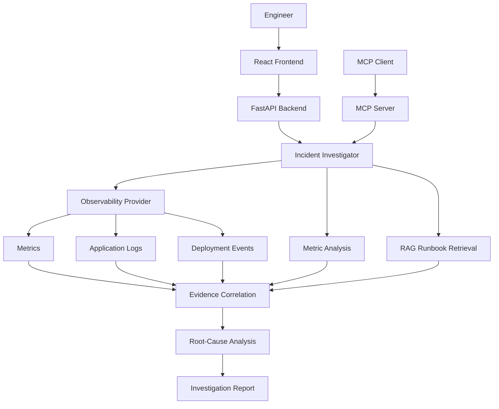

# OpsPilot — Agentic AI Incident Investigator

**Repository:** [github.com/Srinu0725/opspilot](https://github.com/Srinu0725/opspilot)

OpsPilot is an agentic AI incident-investigation prototype that correlates service metrics, application logs, deployment events, and runbook knowledge to identify likely root causes and recommend troubleshooting steps.

It exposes investigation capabilities through a FastAPI backend and a Model Context Protocol (MCP) server, making its tools accessible to compatible AI clients.

> **Demo transparency:** The current demonstration uses local/simulated observability data. It is not connected to live production monitoring. Uploaded incident reports are treated as unverified context, and root-cause conclusions require independent validation.

## Key Features

- **Incident investigation:** Collects metrics, logs, deployment information, and relevant runbook guidance.
- **Anomaly detection:** Compares latency, database performance, error rates, traffic, CPU, and memory against a baseline.
- **Evidence correlation:** Builds an investigation timeline from available metrics, logs, and deployment events.
- **RAG-based troubleshooting:** Retrieves relevant runbook sections using semantic search.
- **Root-cause analysis:** Produces likely causes, supporting evidence, confidence assessments, missing evidence, and recommended next steps.
- **MCP integration:** Exposes investigation, metrics, and runbook-search tools.
- **Web interface:** Provides a frontend for interacting with the incident-investigation workflow.

## Architecture



## Technology Stack

- **Frontend:** React, JavaScript, CSS
- **Backend:** Python, FastAPI, Uvicorn
- **Agent/tool integration:** Model Context Protocol (MCP), FastMCP
- **Retrieval:** Embeddings and semantic runbook search
- **Testing:** pytest
- **Demo telemetry:** Local/simulated observability fixtures

## Project Structure

```text
opspilot/
├── app/
│   ├── api/routes/
│   ├── observability/
│   ├── rag/
│   ├── tools/
│   ├── main.py
│   ├── mcp_server.py
│   └── web_api.py
├── data/
│   ├── deployments/
│   ├── logs/
│   └── metrics/
├── frontend/
│   └── src/
├── scripts/
├── requirements.txt
├── pytest.ini
├── conftest.py
└── README.md
```

## Prerequisites

- Python 3.12
- Node.js and npm
- Git

## Run Locally

### 1. Clone the repository

```bash
git clone https://github.com/Srinu0725/opspilot.git
cd opspilot
```

### 2. Install backend dependencies

On Windows PowerShell:

```powershell
py -3.12 -m venv .venv
.\.venv\Scripts\Activate.ps1
python -m pip install -r requirements.txt
```

Ensure the requirements include the tested MCP version:

```text
mcp==1.30.0
```

### 3. Start the FastAPI backend

```powershell
.\.venv\Scripts\python.exe -m uvicorn app.main:app --reload --port 8002
```

Open the interactive API documentation at:

http://127.0.0.1:8002/docs

### 4. Start the MCP server

In a separate terminal:

```powershell
.\.venv\Scripts\python.exe -m app.mcp_server
```

Default MCP endpoint:

```text
http://127.0.0.1:8000/mcp
```

The server uses Streamable HTTP transport.

### 5. Start the frontend

In a separate terminal:

```powershell
cd frontend
npm install
npm run dev
```

Open the local URL printed by Vite in the terminal. Configure the frontend's API base URL according to the existing implementation in `frontend/src/api.js`.

## MCP Tools

OpsPilot registers the following MCP tools:

| Tool | Description |
|---|---|
| `investigate_service` | Runs an investigation for a specified service |
| `get_metrics` | Retrieves service metrics |
| `find_runbook_guidance` | Searches runbooks for relevant troubleshooting guidance |

Example investigation arguments:

```json
{
  "service": "payment-api"
}
```

Example runbook search arguments:

```json
{
  "service": "payment-api",
  "query": "database latency and slow payment lookup queries",
  "top_k": 3
}
```

The current MCP investigation wrapper accepts a service name. The underlying investigation function also supports optional time bounds and incident-report context, but those optional inputs are not exposed by this MCP tool yet.

## Example Scenario

Suppose the Payment API experiences increasing response latency.

OpsPilot examines the available metrics, searches application logs, checks recent deployment information, and retrieves relevant runbook instructions. It can identify a likely relationship between slow database queries and a recent deployment, then recommend checking query plans, index usage, database contention, and deployment changes.

A temporal correlation is not proof of causation. The proposed root cause should be validated using independent evidence.

## Testing

Validate installed dependencies:

```powershell
.\.venv\Scripts\python.exe -m pip check
```

Run the automated test suite:

```powershell
.\.venv\Scripts\python.exe -m pytest -q
```

Development validation completed with no broken requirements and four passing automated tests. MCP smoke tests also confirmed successful tool discovery, metrics retrieval, runbook retrieval, and incident investigation.

## Deployment

The frontend can be deployed as a static React/Vite site. The FastAPI backend and MCP server require separate hosting or an appropriately configured server environment.

Before deploying the frontend, configure its API base URL to point to the publicly reachable backend. Enable the required CORS origins on the backend and configure any necessary environment variables. Do not expose API keys or credentials in frontend code.

The frontend deployment alone does not make the backend or MCP server publicly accessible.

## Limitations and Responsible Use

- The demonstration uses local/simulated observability data rather than live production telemetry.
- Uploaded incident reports are user-provided context and are not automatically verified.
- RCA results are hypotheses and may require human investigation.
- The demo provides advisory remediation guidance; it does not automatically modify production infrastructure.
- Authentication, authorization, network controls, and production-grade observability integration should be configured before real-world deployment.

## Future Improvements

- Integrate live observability platforms.
- Add richer evidence provenance and confidence calibration.
- Expose investigation windows and incident-report context through MCP.
- Improve audit history and investigation replay.
- Add human-approved remediation workflows and broader integration tests.
